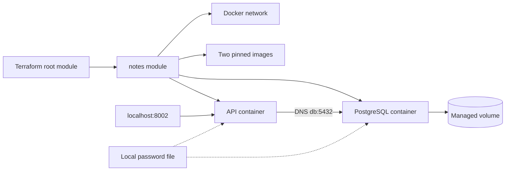

# Terraform Lab — Infraestrutura local como código

[English](README.en.md) | Português

[](https://github.com/tommmdl/terraform-lab/actions/workflows/validate.yml)

Terraform provisiona uma aplicação de notas com PostgreSQL no Docker. O projeto reutiliza a imagem do `docker-lab` publicada no GHCR e modela os recursos diretamente no provider Docker, sem executar Compose ou comandos de provisionamento via `local-exec`.

**Não exige conta cloud nem cria recursos de cloud paga.** Utiliza CPU, memória, disco e rede locais. O objetivo é demonstrar módulos, dependências, variáveis, plano, state, idempotência, drift e destruição controlada.

## Pré-requisitos e preparação

Linux/WSL com daemon Docker acessível, Bash, Python 3, curl e Git. Porta local 8002 livre. A primeira execução precisa de internet para baixar Terraform, provider e imagens. O instalador automático suporta Linux x86_64; em outra plataforma, instale Terraform compatível previamente. O endpoint padrão é `unix:///var/run/docker.sock`.

```bash
git clone https://github.com/tommmdl/terraform-lab.git
cd terraform-lab
bash scripts/prepare.sh
bash scripts/tf.sh init -input=false
bash scripts/tf.sh fmt -check -recursive
bash scripts/tf.sh validate
```

O script preserva uma senha existente e gera `.local/db-password` quando necessário. Se Terraform não estiver instalado, baixa a versão 1.14.9 oficial e verifica o SHA-256 do arquivo. O binário fica em `.local/bin/`; o wrapper `tf.sh` usa esse binário ou o Terraform do sistema. O download é verificado por checksum do distribuidor, sem verificação de assinatura GPG do arquivo de checksums.

## Revisar e aplicar

```bash
bash scripts/tf.sh plan -out=.local/create.tfplan
bash scripts/tf.sh show .local/create.tfplan
bash scripts/tf.sh apply .local/create.tfplan
bash scripts/tf.sh output
curl http://127.0.0.1:8002/readyz
```

O plano inicial cria **seis recursos gerenciados**: rede, volume PostgreSQL, duas imagens e dois containers. `apply` do plano salvo executa exatamente aquele plano sem nova confirmação interativa; revise o `show` antes. Abra http://localhost:8002 para usar a interface em português/inglês.

## Arquitetura e dependências



A pasta raiz configura provider, backend local, variáveis e outputs. `modules/notes` encapsula rede, volume, imagens, containers e dependências. A API só é criada após o container do banco passar no healthcheck; `wait = true` também aguarda prontidão da API.

As referências entre recursos formam o grafo de dependências. O `depends_on` explícito da API acrescenta a dependência de prontidão do banco, além da rede/imagem. A API acessa o banco pelo alias `db`. Somente a porta da API é publicada, vinculada a `127.0.0.1`.

A API usa UID 10001, rootfs somente leitura, `/tmp` temporário e capabilities removidas. As imagens são fixadas por digest e o provider Docker em 4.6.0; `.terraform.lock.hcl` deve ser versionado. O provider usa a autoridade de acesso do usuário ao Docker local.

## Variáveis e outputs

| Entrada | Padrão | Validação/uso |
| --- | --- | --- |
| `docker_host` | Socket Docker local | Endpoint acessível pelo processo Terraform |
| `name_prefix` | `terraform-lab` | Prefixo isolado, com sufixo opcional em minúsculas |
| `api_port` | `8002` | Inteiro entre 1024 e 65535 |
| `api_image` | Imagem GHCR por digest | Repositório docker-lab e SHA-256 completos |

Copie `terraform.tfvars.example` para `terraform.tfvars` se quiser ajustar o ambiente. Arquivos `.tfvars` locais são ignorados pelo Git. Outputs: `api_url` e `resource_names`.

```bash
bash scripts/tf.sh plan -var=api_port=8003 -out=.local/custom.tfplan
```

Mantenha as mesmas entradas ao aplicar/replanejar/destruir. Se mantiver estados independentes em outra pasta, use prefixos e portas diferentes. Não altere o prefixo para nomes já usados por recursos de outro state.

## Idempotência, persistência e drift

```bash
bash scripts/tf.sh plan -detailed-exitcode
```

Códigos: `0` sem alterações, `2` com alterações planejadas, `1` erro. Um plano após um apply convergente deve retornar 0.

O volume tem ciclo de vida separado dos containers. Substituir os dois containers preserva as notas enquanto o volume permanece. Parar a API fora do Terraform demonstra drift; um novo plan detecta que ela não está executando, e apply reconcilia a configuração. Terraform não supervisiona continuamente o serviço: a reconciliação só ocorre quando executado.

## Validação de ciclo completo

**O teste exige um state dedicado vazio e termina apagando o volume e os dados de teste deste laboratório.** Não execute em um ambiente com notas que deseja preservar.

```bash
python3 scripts/verify.py
```

O teste verifica formatação, configuração, rejeição de porta inválida, plano inicial, apply, API, plano sem alterações, substituição dos dois containers com persistência, drift por parada da API, reconciliação, plano de destroy e remoção de todos os recursos gerenciados. Só exporta checks e ações dos planos; state e planos brutos permanecem locais.

[Resultados reais e evidências](docs/validation.md).

## State e segredos

O backend local usa `.local/terraform.tfstate`, com backups na mesma pasta. State, planos, `.terraform/` e senha não entram no Git. O Terraform recebe apenas o **caminho** do arquivo de senha, sem usar `file()` para carregar seu conteúdo em atributos. Ainda assim, o state pode conter metadados e caminhos privados e deve ser protegido. `sensitive` sozinho não criptografa state.

No Linux, `.local/` usa modo 0700 e o arquivo de senha 0644 para permitir leitura pelo UID da API no bind mount. ACLs Windows/DrvFS podem se comportar de outro modo. Não apague nem troque a senha de um banco existente sem planejar rotação. Este backend não configura armazenamento remoto compartilhado, criptografia remota ou colaboração entre máquinas.

## Destruir e custos

```bash
bash scripts/tf.sh plan -destroy -out=.local/destroy.tfplan
bash scripts/tf.sh show .local/destroy.tfplan
bash scripts/tf.sh apply .local/destroy.tfplan
bash scripts/tf.sh state list
```

**Destroy remove também o volume PostgreSQL e todas as notas deste state.** Salve dados necessários antes. As imagens usam `keep_locally = true`: saem do state, mas ficam no cache Docker para não afetar outros laboratórios que as utilizem. Senha, binário, providers e logs locais também permanecem. Não apague o state antes de destruir ou planejar uma migração: isso perde o vínculo com os recursos.

## CI e troubleshooting

GitHub Actions executa `fmt`, `init -backend=false -lockfile=readonly` e `validate` em pushes/PRs com mudanças Terraform e em execução manual. O CI não aplica nem destrói infraestrutura; o teste completo é local. Actions fixadas por SHA e token com `contents: read`.

- Permissão negada no socket: verifique daemon/acesso do usuário e integração WSL; este ambiente gerenciado exige execução autorizada fora do sandbox. Não exponha o socket a todos.
- API unhealthy: consulte `docker logs terraform-lab-api` e `docker logs terraform-lab-db`; confirme senha legível e banco healthy.
- Recurso com nome já existente: confira state/prefixo antes de agir; não remova recursos alheios para resolver o conflito.
- Mudança inesperada no plan: reveja entradas, versão do provider e recursos alterados fora do Terraform.
- Pasta movida: o bind mount da senha usa caminho absoluto; mover a pasta pode planejar recriação de containers.

## Limites e próximos passos

Laboratório local, sem SLA, autenticação de usuários, TLS, backup/restauração, migrações versionadas ou usuário de banco com privilégios mínimos. A aplicação mantém os limites descritos no `docker-lab`. O próximo passo cloud exigirá escolher provedor, backend remoto, identidade e orçamento; nada disso é configurado implicitamente aqui.

## Referências

- [Terraform Docker tutorial](https://developer.hashicorp.com/terraform/tutorials/docker-get-started)
- [Docker provider 4.6.0](https://registry.terraform.io/providers/kreuzwerker/docker/4.6.0/docs)
- [Terraform state and sensitive data](https://developer.hashicorp.com/terraform/language/state/sensitive-data)
- [Terraform plan command](https://developer.hashicorp.com/terraform/cli/commands/plan)
- [Application source](https://github.com/tommmdl/docker-lab)
- [CI and GHCR publication](https://github.com/tommmdl/github-actions-lab)
- [Portfolio](https://github.com/tommmdl/devops-portfolio)
