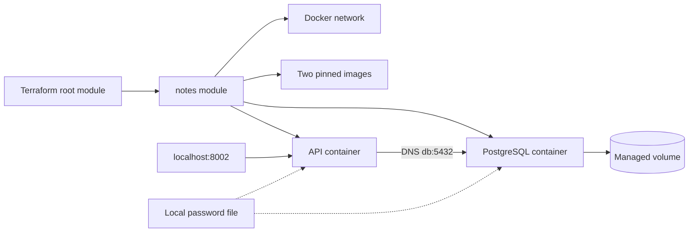

# Usage guide

[Português](guide.md) | [Back to the project](../README.en.md)

Run commands from the repository root.

## Prerequisites and setup

Linux/WSL with an accessible Docker daemon, Bash, Python 3, curl and Git. Local port 8002 available. First execution requires internet for Terraform, provider and images. Automatic installation supports Linux x86_64; install compatible Terraform beforehand on other platforms. Default daemon endpoint: `unix:///var/run/docker.sock`.

```bash
git clone https://github.com/tommmdl/terraform-lab.git
cd terraform-lab
bash scripts/prepare.sh
bash scripts/tf.sh init -input=false
bash scripts/tf.sh fmt -check -recursive
bash scripts/tf.sh validate
```

Preparation preserves existing passwords and creates `.local/db-password` if needed. If Terraform is absent, it downloads official version 1.14.9 and checks the archive SHA-256. The binary lives under `.local/bin/`; `tf.sh` uses that binary or system Terraform. Download verification uses distributor checksums without checking the checksum file's GPG signature.

## Review and apply

```bash
bash scripts/tf.sh plan -out=.local/create.tfplan
bash scripts/tf.sh show .local/create.tfplan
bash scripts/tf.sh apply .local/create.tfplan
bash scripts/tf.sh output
curl http://127.0.0.1:8002/readyz
```

The initial plan creates **six managed resources**: a network, PostgreSQL volume, two images and two containers. Applying a saved plan executes that plan without another interactive confirmation; review `show` first. Open http://localhost:8002 for the Portuguese/English interface.

## Architecture and dependencies



The root configures provider, local backend, variables and outputs. `modules/notes` encapsulates the network, volume, images, containers and dependencies. The API is created after the database container passes its healthcheck; `wait = true` also waits for API readiness.

Resource references build the dependency graph. Explicit API `depends_on` adds database readiness ordering beyond network/image references. The API reaches PostgreSQL using alias `db`. Only the API port is published, bound to `127.0.0.1`.

The API runs as UID 10001 with a read-only rootfs, temporary `/tmp` and capabilities dropped. Images are pinned by digest and Docker provider to 4.6.0; commit `.terraform.lock.hcl`. Provider access carries the authority of the user's Docker daemon access.

## Variables and outputs

| Input | Default | Validation/use |
| --- | --- | --- |
| `docker_host` | Local Docker socket | Endpoint reachable by Terraform |
| `name_prefix` | `terraform-lab` | Isolated prefix with optional lowercase suffix |
| `api_port` | `8002` | Integer from 1024 through 65535 |
| `api_image` | GHCR digest reference | docker-lab repository and complete SHA-256 |

Copy `terraform.tfvars.example` to `terraform.tfvars` for local settings. Local `.tfvars` files are ignored. Outputs: `api_url` and `resource_names`.

```bash
bash scripts/tf.sh plan -var=api_port=8003 -out=.local/custom.tfplan
```

Keep inputs consistent when applying, replanning and destroying. Independent states in other directories require distinct prefixes and ports. Do not reuse names belonging to resources managed by another state.

## Idempotence, persistence and drift

```bash
bash scripts/tf.sh plan -detailed-exitcode
```

Exit codes: `0` no changes, `2` planned changes, `1` error. A plan after a converged apply should return 0.

The volume has an independent lifecycle. Replacing both containers preserves notes while the volume remains. Stopping the API outside Terraform demonstrates drift; the next plan detects the stopped container and apply reconciles configuration. Terraform is not continuous supervision: reconciliation runs only when invoked.

## Full lifecycle verification

**The test requires an empty dedicated state and deletes the lab's test data and volume at completion.** Do not run against an environment containing notes you want to preserve.

```bash
python3 scripts/verify.py
```

Checks formatting, configuration, invalid port rejection, initial plan, apply, API, no-op plan, replacement of both containers with persistence, API stop drift, reconciliation, destroy plan and removal of managed resources. Only checks and curated plan actions are exported; raw state and plans remain local.

If interrupted or failed, the test may leave resources behind. Inspect `state list` and a destroy plan; do not delete state to bypass the empty-state guard.

[Actual results and evidence](../docs/validation.en.md).

## State and secrets

The local backend uses `.local/terraform.tfstate`, with backups in the same directory. State, plans, `.terraform/` and passwords are excluded from Git. Terraform receives only the password file **path**, without `file()` loading its contents into resource attributes. State may still include private metadata/paths and must be protected. `sensitive` alone does not encrypt state.

On Linux, `.local/` has mode 0700 and the password file 0644 so the API UID can read its bind mount. Windows/DrvFS ACLs may differ. Do not delete/change an existing database password without planning rotation. No shared remote backend, remote encryption or cross-machine collaboration is configured.

## Teardown and costs

```bash
bash scripts/tf.sh plan -destroy -out=.local/destroy.tfplan
bash scripts/tf.sh show .local/destroy.tfplan
bash scripts/tf.sh apply .local/destroy.tfplan
bash scripts/tf.sh state list
```

**Destroy also removes the PostgreSQL volume and all notes managed by this state.** Save required data first. Images use `keep_locally = true`: removed from state but retained in Docker cache to avoid affecting other labs. Password, binary, provider cache and local logs also remain. Do not delete state before teardown or a planned migration: this loses resource ownership tracking.

## CI and troubleshooting

GitHub Actions runs `fmt`, `init -backend=false -lockfile=readonly` and `validate` for Terraform changes on pushes/PRs and manual runs. CI does not apply/destroy infrastructure; the full lifecycle test is local. Actions are SHA-pinned and token permissions are `contents: read`.

- Docker socket permission denied: check daemon access and WSL integration; this managed environment requires authorized execution outside the sandbox. Do not make the socket world-accessible.
- API unhealthy: inspect `docker logs terraform-lab-api` and `docker logs terraform-lab-db`; confirm readable password and healthy database.
- Existing resource name: inspect state/prefix before acting; do not remove unrelated resources to resolve conflicts.
- Unexpected plan changes: check inputs, provider version and out-of-band resource changes.
- Moved project directory: password mounts use an absolute path; moving the project can plan container replacement.

## Limits and next steps

Local lab without SLA, user authentication, TLS, backup/restore, versioned migrations or a least-privilege database user. Application limits from `docker-lab` still apply. A cloud version will require an explicit provider, remote backend, identity and budget choice; none is implicitly configured here.

## References

- [Terraform Docker tutorial](https://developer.hashicorp.com/terraform/tutorials/docker-get-started)
- [Docker provider 4.6.0](https://registry.terraform.io/providers/kreuzwerker/docker/4.6.0/docs)
- [Terraform state and sensitive data](https://developer.hashicorp.com/terraform/language/state/sensitive-data)
- [Terraform plan command](https://developer.hashicorp.com/terraform/cli/commands/plan)
- [Application source](https://github.com/tommmdl/docker-lab)
- [CI and GHCR publication](https://github.com/tommmdl/github-actions-lab)
- [Portfolio](https://github.com/tommmdl/devops-portfolio)
